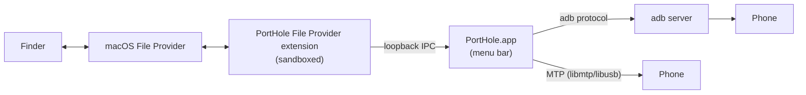

# PortHole

**Your Android phone, right in Finder.**

PortHole is a free, open-source menu-bar app for macOS. It mounts Android phones as Finder locations, so you can browse, open, copy, rename and delete phone files like any other folder. No Android app is needed on the phone.

| | |
|---|---|
| **Connect by** | USB in “File transfer” mode (MTP), or USB debugging over USB or Wi-Fi (ADB) |
| **Works with** | macOS 14 Sonoma or later · Apple Silicon and Intel · any Android phone |
| **License** | [MIT](LICENSE): use, copy, modify and redistribute freely |

## Download

1. Download the latest **`PortHole-<version>.dmg`** from [**Releases**](https://github.com/arunesh-singh/PortHole/releases/latest).
2. Open it and drag **PortHole** into **Applications**.
3. Open PortHole. The first time, macOS asks you to confirm because the app isn't notarized by Apple. [Here's how](docs/USER_GUIDE.md#1-install).
4. Turn PortHole on in **System Settings › General › Login Items & Extensions › File Providers**. The menu-bar icon links you there.
5. Connect your phone, unlock it, and choose **File transfer**.

Your phone appears in Finder's sidebar under **Locations**.

📖 **[User Guide](docs/USER_GUIDE.md)**: setup, Wi-Fi, troubleshooting, uninstalling.

## Build it yourself

```sh
brew install xcodegen pkgconf
git clone https://github.com/arunesh-singh/PortHole.git && cd PortHole
make run
```

No Apple Developer account is needed. 🛠 **[Developer Guide](docs/DEVELOPMENT.md)** covers architecture, debugging, testing and releasing. Contributions are welcome: see [CONTRIBUTING.md](CONTRIBUTING.md).

## How it works, in one picture



## Acknowledgements

- [libmtp](https://github.com/libmtp/libmtp) and [libusb](https://libusb.info), both LGPL-2.1, are linked statically. You can relink PortHole against modified versions of them by rebuilding from this repository, which is what the LGPL requires.
- The ADB transport talks the documented [adb server protocol](https://android.googlesource.com/platform/packages/modules/adb/+/refs/heads/main/SERVICES.TXT) directly.

PortHole is not affiliated with Google or Android. Android is a trademark of Google LLC.
