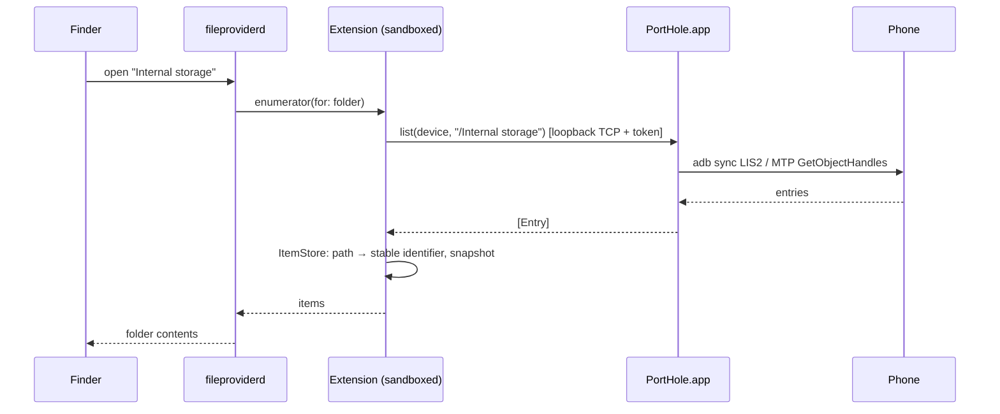

# PortHole Developer Guide

Everything you need to build, understand, debug, change and ship PortHole.

- [Quick start](#quick-start)
- [Repository layout](#repository-layout)
- [Architecture](#architecture)
- [Signing: ad-hoc vs. your own team](#signing-ad-hoc-vs-your-own-team)
- [Debugging](#debugging)
- [Testing](#testing)
- [Common changes](#common-changes)
- [Releasing](#releasing)
- [Gotchas we've hit](#gotchas-weve-hit)

## Quick start

**Requirements:** macOS 14+, Xcode 16+, [Homebrew](https://brew.sh), and Xcode's command-line tools (`xcode-select --install`).

```sh
brew install xcodegen pkgconf             # project generator; pkgconf is needed to build libmtp
brew install android-platform-tools       # optional: adb, for the ADB transport
git clone https://github.com/arunesh-singh/PortHole.git && cd PortHole
make run                                  # builds deps (first time), the app, and launches it
```

The first `make` builds universal static libusb and libmtp into `Vendor/` (about a minute). After launching, turn on PortHole under **System Settings › General › Login Items & Extensions › File Providers**.

| Command | Does |
|---|---|
| `make run` | Debug build (ad-hoc signed) and relaunch the app |
| `make build` | Debug build only |
| `make cli` | Build the `porthole` command-line tool (`build/dd/Build/Products/Debug/porthole`) |
| `make project` | Regenerate `PortHole.xcodeproj`, e.g. to open it in Xcode |
| `make dmg` | Universal, ad-hoc signed DMG in `build/release/` |
| `make release` | Developer ID signed + notarized DMG (see [Releasing](#releasing)) |
| `make clean` | Remove `build/` and the generated project |

`PortHole.xcodeproj` is generated and git-ignored. Edit `project.yml`, never the project file. To use Xcode, run `make project` and open the project, then select the **PortHole** scheme. To build in Xcode without a team, set Signing to "Sign to Run Locally".

## Repository layout

```
project.yml                 XcodeGen spec: targets, settings, linking
Makefile                    developer entry points
scripts/
  build-deps.sh             universal static libusb + libmtp → Vendor/
  release.sh                DMG builder (ad-hoc or Developer ID + notarization)
  ExportOptions.plist       Developer ID export settings
Sources/
  App/                      menu-bar app (unsandboxed)
    PortHoleApp.swift         @main, MenuBarExtra, quit handling
    AppModel.swift            device state, mounting policy, settings
    DomainController.swift    NSFileProviderDomain add/remove/refresh
    IPCServer.swift           loopback server for the extension + DeviceRegistry
    MenuView.swift            menu UI, Wi-Fi pairing
    SettingsView.swift        settings window
  Core/                     transports (shared by app and CLI)
    DeviceBackend.swift       the protocol every transport implements
    ADB/                      adb server protocol: host services, sync, shell
    MTP/                      libmtp wrapper + IOKit USB hot-plug monitor
    CMTP/module.modulemap     exposes libmtp.h to Swift
  Extension/                File Provider extension (sandboxed)
    FileProviderExtension.swift  NSFileProviderReplicatedExtension
    Enumerators.swift         folder, working-set (change detection) and empty enumerators
    ItemStore.swift           SQLite: stable identifiers ↔ paths, folder snapshots
    FileProviderItem.swift    NSFileProviderItem
    DeviceClient.swift        IPC client + error mapping
  Shared/                   compiled into every target
    Wire.swift                paths/constants, IPC message types
    VPath.swift               virtual device paths
    Socket.swift              blocking TCP socket + JSON framing
  CLI/main.swift            `porthole` tool
docs/                       user and developer documentation
```

## Architecture



### Processes and why there are two

| Process | Sandboxed | Owns |
|---|---|---|
| **PortHole.app** | No | USB (libusb/libmtp), the adb server connection, File Provider domains, the menu UI |
| **PortHoleFileProvider.appex** | Yes (required for File Provider extensions) | Finder integration: items, enumeration, create/modify/delete |

The extension can't touch USB or spawn `adb`, so it asks the app for every device operation. This is the same split MacDroid uses.

### IPC

- The app listens on `127.0.0.1:<random port>` and writes `{port, token}` to `~/Library/Application Support/PortHole/ipc.json`. The directory is mode 0700 and the file 0600; the token is a fresh 256-bit value each launch.
- The extension reads `ipc.json` and opens one TCP connection per request. It sends a length-prefixed JSON `IPCEnvelope {token, request}` and gets back an `IPCResponse`. Requests with a bad token are dropped.
- File **contents** never travel over the socket. They're staged in `~/Library/Application Support/PortHole/Transfers/`, and the request carries the path.
- The extension reaches `~/Library/Application Support/PortHole/` through a `temporary-exception.files.home-relative-path.read-write` entitlement.

Why not an app-group container and a unix socket? Two reasons:
1. macOS only lets a sandboxed extension into an app-group container when the build is team-signed (otherwise TCC "App Data" protection silently denies it). That would make ad-hoc and self-built copies useless.
2. The sandbox refuses `connect()` to unix sockets outside the extension's own container, even with a file exception.

### Device paths (`VPath`)

Every transport exposes the same virtual tree:

```
/                              device root, lists storage volumes
/Internal storage/DCIM/x.jpg   ADB: /sdcard/DCIM/x.jpg
/SD card (1234-ABCD)/…         ADB: /storage/1234-ABCD/…
/Internal shared storage/…     MTP: storage names come from the phone
```

Volume roots are read-only (they can't be renamed or deleted). `DeviceBackend` (`Sources/Core/DeviceBackend.swift`) is the whole contract: `list`, `stat`, `download`, `upload`, `makeDirectory`, `delete`, `move`. All calls block, and all are safe to call from any thread.

### Transports

- **ADB** (`Core/ADB`) speaks the adb *server* protocol on `tcp:5037`; there's no `adb` subprocess per operation. `host:track-devices-l` tracks devices; `sync:` with `STA2/LST2/LIS2/RECV/SEND` handles listing and transfers (falling back to the v1 protocol on old devices); `shell:` handles `mkdir`, `rm` and `mv`. Each call opens its own connection, so calls can run concurrently.
- **MTP** (`Core/MTP`) wraps libmtp. libmtp isn't thread-safe, so every call runs on one serial queue (`MTPQueue`). MTP addresses objects by numeric handle, so paths are resolved by walking listings, with a path→handle cache that is invalidated on mutations and on stale-handle errors. IOKit `IOUSBHostDevice` notifications trigger rescans.

### Finder side (`Extension/`)

- It's a **replicated** File Provider: the system keeps a local copy of what has been browsed and downloads file contents on demand.
- **Identifiers:** `ItemStore` assigns every path a random UUID and keeps it across renames (`move` rewrites the paths of a whole subtree). It lives in SQLite at `Application Support/PortHole/Domains/<domain>.sqlite`.
- **Changes made on the phone:** devices don't send change notifications, so the app signals the *working set* every N seconds. The working-set enumerator re-lists every folder the system has enumerated (the `listed` table), diffs it against the stored snapshot, and reports updates and deletions.
- **One domain per device**, with the domain ID equal to `DeviceInfo.id` (`adb-<serial>` / `mtp-<serial>`). Display names are made unique (`RMX5085`, `RMX5085 (MTP)`) because Finder folders are named after them.
- **Domain lifecycle (`DomainController`):** a domain's database is reset only when the domain is created or removed, never when the app re-adopts a domain that survived a crash or kill. Domains not backed by a device are removed 6 s after launch, and all domains are removed on Quit.

## Signing: ad-hoc vs. your own team

| | Ad-hoc (`make run`, `make dmg`, CI) | Your team (Developer ID) |
|---|---|---|
| Apple account needed | No | Yes, a paid Apple Developer Program membership |
| Runs on your Mac | Yes | Yes |
| Runs on other Macs | Yes, after **Open Anyway** once | Yes, no warning (once notarized) |
| File Provider works | Yes | Yes |

`DEVELOPMENT_TEAM` in `project.yml` is only used for Developer ID builds (`make release`). Forks that want signed releases should change it there and in `scripts/ExportOptions.plist`. Nothing else is tied to a team.

## Debugging

**Logs.** Everything logs under the subsystem `com.arunesh.porthole`:

```sh
log stream --level info --predicate 'subsystem == "com.arunesh.porthole"'
# extension crashes, sandbox and File Provider errors:
log show --last 5m --predicate 'process == "PortHoleFileProvider" OR (process == "fileproviderd" AND eventMessage CONTAINS[c] "porthole")'
```

**File Provider state.** This shows the domain's status, errors and throttled operations:

```sh
fileproviderctl dump com.arunesh.porthole.fileprovider -l | less
```

Look for `enabled: no` (the user hasn't approved the extension), and 🛑 lines for operations that failed with an error.

**Transports without Finder.** `make cli`, then:

```sh
P=build/dd/Build/Products/Debug/porthole
$P devices
$P adb ls "/Internal storage"
$P adb push file.txt "/Internal storage/Download/file.txt"
$P mtp ls /          # quit PortHole first: only one process can hold an MTP device
```

**No phone handy?** The Android emulator works for everything except MTP:

```sh
~/Library/Android/sdk/emulator/emulator -list-avds
~/Library/Android/sdk/emulator/emulator -avd <name> -no-window
```

It appears as `adb-emulator-5554` and mounts like a phone.

**Debugging the extension in Xcode:** run the PortHole scheme, then use **Debug › Attach to Process › PortHoleFileProvider** once Finder has touched the location.

## Testing

There's no unit-test target yet. Behavior depends on real devices and the File Provider daemon, so changes are verified by exercising them. Before opening a PR that touches transports or the extension, run through this with a phone or the emulator:

1. The device appears in the menu and mounts in Finder.
2. Browse two levels deep.
3. Create a folder, copy a large file (≥ 50 MB) in, rename it, move it to another folder, and delete the folder. Check each step on the device (`adb shell ls`, or the `porthole` CLI).
4. Create a file on the device (`adb push`), click ↻, and check that it appears. Open it and compare it with `cmp`.
5. Delete that file on the device, click ↻, and check that it disappears.
6. Unplug: the location goes away. Plug back in: it returns.
7. Quit and relaunch PortHole: it mounts again, with no 🛑 errors in `fileproviderctl dump`.

CI (`.github/workflows/ci.yml`) builds the app, the extension and the CLI for both architectures on every push and pull request.

## Common changes

**Add a transport.** Implement `DeviceBackend` in `Sources/Core/<Name>/`. Then add discovery that produces backends (like `ADBTracker` or `MTPMonitor`), feed it into `AppModel` (keep `registry` and `reconcile()` in sync), and add a `TransportKind` case.

**Add an IPC operation.** Add a case to `IPCRequest` (`Shared/Wire.swift`), handle it in `IPCServer.handle`, and add a method to `DeviceClient`. Both sides ship in the same bundle, so there's no versioning concern.

**Change on-disk state** (`ItemStore` schema). Domain databases are disposable: they're reset whenever a domain is created. Bump the file name or drop and recreate the tables. No migration is needed.

**Code style.** Match the surrounding code. The project uses Swift 5 language mode with `@unchecked Sendable` only where a lock or queue protects the state; say which one in a comment.

## Releasing

**Ad-hoc release (anyone can do this, no Apple account).** Bump `MARKETING_VERSION` in `project.yml`, commit, and push a tag:

```sh
git tag v0.2.0 && git push origin v0.2.0
```

`.github/workflows/release.yml` builds a universal ad-hoc DMG and publishes it as a GitHub pre-release. Locally, `scripts/release.sh --adhoc [--publish]` does the same.

**Developer ID release (no Gatekeeper warning).** One-time setup:
1. A **Developer ID Application** certificate for `DEVELOPMENT_TEAM` in your login keychain.
2. `xcrun notarytool store-credentials porthole-notary --apple-id <id> --team-id <team> --password <app-specific-password>`

Then run `scripts/release.sh --publish`. It archives, exports with Developer ID, notarizes and staples the app and the DMG, uploads the release, and writes `build/release/porthole.rb`, a Homebrew cask with the right version and sha256, ready for a `homebrew-porthole` tap.

## Gotchas we've hit

- **Several copies of the app confuse macOS.** If Launch Services knows more than one `PortHole.app` (old build folders, a mounted DMG), adding a domain fails with *"The application cannot be used right now."* Unregister stale copies:
  `/System/Library/Frameworks/CoreServices.framework/Frameworks/LaunchServices.framework/Support/lsregister -u <path-to-old-PortHole.app>`
- **Don't `make clean` while a phone is mounted.** Quit PortHole first. Deleting the app out from under a live domain triggers the problem above.
- **`ptpcamerad` grabs every Android phone.** macOS's Image Capture agent claims the MTP interface on attach and ignores SIGTERM. `MTPMonitor` SIGKILLs it right before opening a new device; it relaunches on demand.
- **libmtp resets Android phones on close.** Every `porthole mtp …` CLI call ends with a USB reset, which also drops adb for a moment. The app keeps devices open, so this only happens on unplug or quit.
- **MTP root parent handle.** New objects at a storage root need parent `0xFFFFFFFF` (Android rejects `0`); `MoveObject` uses `0` for the root.
- **`pkill` is not Quit.** Killing the app skips domain cleanup. On the next launch the surviving domains are re-adopted, and their databases are kept on purpose.
